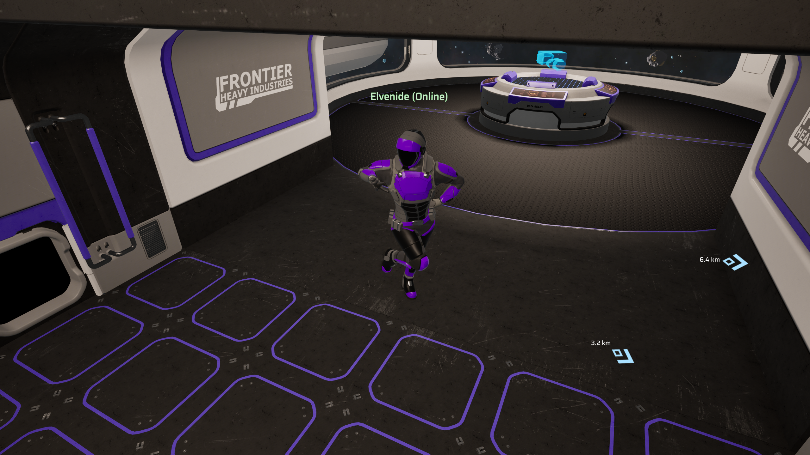

# Elvenide's Freecam Toggle

**Elvenide's Freecam Toggle** is a single-keybind cinematic freecam toggle for **Main Sequence** that switches Spectator Mode and Hide HUD on or off simultaneously, built with UE4SS Lua.

It is designed to feel native to the base game—matching its exact UI style—and is **100% save-safe and removable** without adding custom items, machines, or save dependencies.

## Getting Started

- **[Getting Started & Installation Guide](docs/get-started.md)**

## Cinematic Freecam

Toggle built-in **Spectator Mode** and **Hide HUD** together with a single keypress for clean screenshots and cinematic camera movement.

*Cinematic Freecam active inside a space station with the HUD hidden and free-flying Spectator Mode enabled.*

### Usage

- Press **`C`** (default) at any time in-game to enable both Spectator Mode and Hide HUD.
- Press **`C`** again to exit Spectator Mode and restore the HUD.

### Configuration

- **In-Game**: Open **Settings → Controls** and look for **Cinematic Freecam** to rebind the key.
- **Config File**: Stored in `ElvenidesFreecamToggle/config.json` under `"CinematicFreecamKey"`.

## Credits

**Elvenide's Freecam Toggle** is created and maintained by Elvenide. This is an unofficial mod and I'm not affiliated with Main Sequence.

> If you have questions or run into issues, feel free to reach out in #modding-guides within the [official Main Sequence Discord server](https://discord.com/invite/uy8w2pTcQE).
